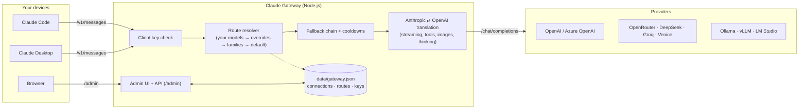

<div align="center">


# Claude Gateway

**Run Claude Code against OpenAI or any OpenAI-compatible provider, from every device on your tailnet.**

[](https://nodejs.org)
[](./package.json)
[](#option-b-docker)
[](#option-c-a-server-on-your-tailnet)
[](./LICENSE)

<p align="center">
  <a href="#-quick-start">Quick Start</a> •
  <a href="#-why-claude-gateway">Why</a> •
  <a href="#%EF%B8%8F-architecture">Architecture</a> •
  <a href="#%EF%B8%8F-admin-ui">Admin UI</a> •
  <a href="#-routing--fallbacks">Routing & Fallbacks</a> •
  <a href="#-providers">Providers</a> •
  <a href="#-security">Security</a>
</p>

---

</div>

Claude Gateway is a small Node.js server that sits between **Claude Code** (or Claude Desktop) and the model
providers you choose. It translates the Anthropic Messages API, including streaming, tool use, images and
thinking, to OpenAI's `/chat/completions` and back. A built-in admin UI manages providers, routing and
per-device keys.

> [!IMPORTANT]
> **Your keys, your server, your tailnet.**
> The gateway runs on your machine and talks to your providers directly. It is built to be reached from your
> own devices over Tailscale, never from the public internet.

---

## 🌟 Why Claude Gateway?

| Feature | What it does | Why it matters |
| :--- | :--- | :--- |
| **🔀 Any OpenAI-compatible provider** | OpenAI, Azure OpenAI, OpenRouter, DeepSeek, Groq, Venice, Ollama, vLLM, LM Studio and more, each with its own key and auth scheme. | Use the models you already pay for, or free and local ones, without leaving Claude Code. |
| **🧭 Routing per model** | Opus, Sonnet, Haiku and Fable each get a connection and model; add your own entries to Claude Code's `/model` picker. | A strong model for real work, a cheap one for Claude Code's many small background calls. |
| **🛟 Fallbacks** | Up to five backup targets per route. On a rate limit, quota error or outage, the request moves to the next one at once. | A capped free tier (NVIDIA, Groq, …) can be your first choice without stopping your session. |
| **🖥️ Admin UI** | Connections, routing, client keys, live requests and health, with no build step. | Change anything from a browser on any device; changes apply to the next request. |
| **🔑 Keys per device** | Name, copy, rename and revoke keys; usage is tracked per key. | Lose a laptop, revoke its key; everything else keeps working. |
| **⚡ Low overhead, zero dependencies** | Only Node.js built-ins: about 3 ms added to time-to-first-byte and 0.01 ms per streamed chunk. | Nothing to audit but this repo, and nothing you'll notice in use. |

Claude Code features that need care are handled: model families route automatically, context overflow
triggers Claude Code's auto-compaction, and pressing **Esc** stops generation upstream.

---

## 🏗️ Architecture



A request carries a client key, is matched to a route, and is translated and sent to the route's target.
If that target is rate-limited, out of quota or down, the next fallback takes it. The reply is translated back
to Anthropic's format and streamed to the client.

---

## 🚀 Quick Start

### Option A: Run with Node.js

Requires Node.js 20.12 or newer.

```bash
git clone https://github.com/VeeraChandu/claude-gateway.git
cd claude-gateway
cp .env.example .env      # optional: seeds your first connection
npm start
```

The log prints a one-time **admin setup code**. Open <http://127.0.0.1:8080/admin/>, enter the code and
choose an admin password. Then:

1. **Connections:** add a provider (OpenAI, Venice, DeepSeek, Groq, OpenRouter, Ollama, Azure OpenAI or any
   OpenAI-compatible URL). **Test connection** checks the key and lists the provider's models.
2. **Routing:** pick the connection and model for the default route and, optionally, for Opus, Sonnet,
   Haiku and Fable. Add fallbacks to any of them.
3. **Client keys:** create a key per device, then use **Copy** beside it to get the setup lines with the
   key filled in.

```bash
export ANTHROPIC_BASE_URL=http://127.0.0.1:8080
export ANTHROPIC_API_KEY=cgw_…        # from Copy on the Client keys page
export CLAUDE_CODE_ENABLE_GATEWAY_MODEL_DISCOVERY=1
claude
```

Add the `export` lines to `~/.zshrc` or `~/.bashrc` to keep them. `./run-claude.sh` starts the gateway if
needed and launches Claude Code; it reads the key from `CLAUDE_GATEWAY_KEY` or `GATEWAY_API_KEY`.

### Option B: Docker

```bash
cp .env.example .env               # optional: seeds your first connection, sets DOCKER_BIND/DOCKER_PORT
docker compose up -d --build       # or docker-compose
docker compose logs gateway | grep "setup code"
```

Open <http://127.0.0.1:5175/admin/> and enter the setup code, or set `ADMIN_PASSWORD` in `.env` to skip
that step. Point Claude Code at the same address; **Copy** on the Client keys page fills it in.

- **Port and bind address:** Compose publishes on `DOCKER_BIND:DOCKER_PORT`, default `127.0.0.1:5175`.
  For the tailnet, keep `127.0.0.1` and run `tailscale serve --bg 5175`, or set `DOCKER_BIND` to the
  server's Tailscale IP. Never `0.0.0.0` on a public server.
- **Client keys are always required:** inside the container the gateway listens on `0.0.0.0`, so the
  loopback-only "no key yet" mode doesn't apply. Create a key before using Claude Code.
- **Settings:** `.env` is optional and read by Compose (`${VAR}` expands from your shell). `HOST`, `PORT`
  and `DATA_DIR` are fixed by the compose file; change the published port with `DOCKER_PORT`.
- **Data:** connections, routes, client keys and the admin password live in the `gateway-data` volume and
  survive rebuilds. Back it up with `docker exec claude-gateway cat /data/gateway.json > gateway-backup.json`
  and keep that file private: it holds your keys.
- **Upgrading:** `git pull && docker compose up -d --build`. The image has a healthcheck and shuts down
  gracefully, saving usage counters.

### Option C: A server on your tailnet

The gateway is meant to be reached from your own devices over Tailscale. Two good setups on an Ubuntu server:

- **`tailscale serve` in front (recommended).** The gateway listens on loopback only and Tailscale provides
  HTTPS at your machine's MagicDNS name:

  ```bash
  # .env: HOST=127.0.0.1  PORT=8080
  sudo tailscale serve --bg 8080
  # → https://<machine>.<tailnet>.ts.net   (admin at /admin/)
  ```

- **Bind to the Tailscale IP.** Set `HOST` to the server's `100.x.y.z` address (`tailscale ip -4`) so the
  gateway is only reachable on the tailnet.

For either, use [`deploy/claude-gateway.service`](./deploy/claude-gateway.service), a hardened systemd unit
with install steps in its header that starts after `tailscaled`. Read the setup code with
`journalctl -u claude-gateway | grep "setup code"`. On each device, paste the lines from **Copy** on the
Client keys page; they use the address you opened the admin page with.

---

## 🖥️ Admin UI

Served at `/admin` by the gateway itself: plain HTML and JavaScript, no build step. A sidebar shows a status
dot and count for each page, and **⌘K** / **Ctrl K** jumps to any page or action.

| Page | What you can do |
| :--- | :--- |
| **Overview** | Request, error and token totals since the last restart; a health card per connection; a live table of recent requests, filterable by errors or key. Click a request to see its error, the target that served it, parameters it was retried without and any fallbacks it went through. |
| **Connections** | Add, edit, test and delete providers. Each has its own API key, auth scheme, output-token cap and reasoning-model pattern, and shows its health and the routes that use it. Delete stays disabled while a route or fallback uses it. Keys are write-only: the UI shows only `sk-…a9f2`. |
| **Routing** | One table of rules in the order they're checked. Connections are picked from a dropdown that shows their health; upstream models from a searchable list of what the provider offers, or any name you type. **+ Fallback** adds backup targets. Unsaved changes show a bar, and leaving the page asks first. **Test a model name** shows where a name would go. |
| **Client keys** | Create, rename (click the name), copy, revoke and delete keys, with last use, request count and token totals. **Copy** gives that device's setup lines with its key filled in. |
| **Settings** | Change the admin password (signs out other sessions); server facts and the environment variables behind them. |

Everything lives in `data/gateway.json` (mode `0600`, written atomically). Provider keys and client keys are
stored as-is: the gateway must send provider keys, and client keys are kept so **Copy** can show them again.
A revoked key's copy is deleted; keys made before v2.1 exist only as a SHA-256 hash and can't be copied. The
admin password is an scrypt hash. Back the file up like any other secret.

---

## 🧭 Routing & Fallbacks

### How a model name is routed

| Order | Rule | Matches |
| :---: | :--- | :--- |
| 1 | **Your models** | An exact ID from **Routing → Your models** |
| 2 | **Overrides** | An exact name, then the longest matching prefix |
| 3 | **Non-Claude names** | `claude --model gpt-4.1` goes to the default connection unchanged |
| 4 | **Families** | Any name containing `haiku`, `sonnet`, `opus` or `fable` uses that family's route, so new releases need no changes. A family without a route uses the default |
| 5 | **Default** | Everything else |

Point Haiku at a cheap model: Claude Code makes many small background calls with it.

### More models in Claude Code's `/model` picker

Claude Code's picker has built-in entries: Opus, Sonnet, Haiku, Fable, the `[1m]` variants and `opusplan`.
Each family routes to whatever you set on the Routing page; the `[1m]` variants arrive as the plain model
name, so they share their family's route.

To add your own entries, use **Routing → Your models**: a display name, an ID containing `claude` (Claude Code
ignores IDs without it), a connection and an upstream model. The gateway lists them on `GET /v1/models`, which
Claude Code loads at startup when `CLAUDE_CODE_ENABLE_GATEWAY_MODEL_DISCOVERY=1` is set (it's in the lines
**Copy** gives you). Restart Claude Code after changing your models, or skip the picker with
`claude --model <your-id>`.

If the same gateway serves Claude Desktop, keep those IDs free of vendor names such as `deepseek` or `gpt`;
Desktop hides them. See [Claude Desktop](#-claude-desktop).

### 🛟 Fallbacks

Any rule (default, a family, one of your models or an override) can have up to five fallbacks: other
connection and model pairs, tried in order. Add them with **+ Fallback** on the Routing page.

| | |
| :--- | :--- |
| **When it moves on** | The target answered 429 (rate limit) or 402 (quota), was overloaded or down (408, 5xx, 529), or couldn't be reached. Errors caused by the request itself (400, 401, …) are returned as they are. |
| **No waiting** | A target with a fallback after it isn't retried with backoff; the request goes to the next one at once. Only the last target uses `UPSTREAM_MAX_RETRIES`. |
| **Cooldown** | A target that returned 429 or 402 is tried last for as long as its `Retry-After` says (an hour at most), or a minute if it doesn't say. Its first success ends the cooldown. Cooldowns are in memory and reset on restart. |
| **Visible** | Requests served by a fallback carry a *fallback* tag in **Overview**, with the targets passed over and why. The connection's health card shows *rate-limited · using fallback*. |

A family set to *Same as default* uses the default's fallbacks. Fallbacks happen before any of the reply is
sent; if a provider fails partway through a streamed reply, the error reaches Claude Code.

> [!TIP]
> A free tier with a cap, like NVIDIA's, works well as the first target with a paid provider as its fallback.

---

## 🔌 Providers

Any provider that speaks `POST {baseUrl}/chat/completions`, streams SSE in OpenAI's chunk format and supports
function calling works: OpenAI, Venice, DeepSeek, Groq, OpenRouter, Together, Fireworks, Cerebras, Ollama,
vLLM, llama.cpp, LM Studio and the rest.

Three settings on a connection reach providers that deviate from the plain shape. They live under
**Connections → Edit → Advanced**:

| Setting | Use it for |
| :--- | :--- |
| **Auth scheme** | `Authorization: Bearer` (default), `x-api-key`, a header you name (**Azure OpenAI** uses `api-key`), or none for a local server |
| **Query parameters** | A query string on every request, e.g. Azure's `api-version=2024-10-21` |
| **Retry without rejected parameters** | On by default. When a provider answers 400 naming `temperature`, `top_p`, `max_tokens`, `max_completion_tokens`, `stop` or `parallel_tool_calls`, the gateway drops just those and retries once |

So Azure OpenAI is a normal connection (the **Azure OpenAI** preset fills these in):

```
Base URL         https://YOUR-RESOURCE.openai.azure.com/openai/deployments/YOUR-DEPLOYMENT
Auth scheme      Custom header → api-key
Query parameters api-version=2024-10-21
```

The rejected-parameter retry is logged, recorded on the request in **Overview**, and doesn't count against
`UPSTREAM_MAX_RETRIES`. Turn it off per connection if you'd rather see the provider's error.

```json
{"level":"warn","msg":"upstream rejected parameters; retrying without them","dropped":"temperature, top_p"}
```

> [!WARNING]
> **What won't work:** providers with no `/chat/completions` endpoint at all. Gemini and Vertex native
> (`generateContent`, `?key=`) and Bedrock (SigV4 signing) are separate protocols; point the gateway at a
> provider that speaks OpenAI, or at a translating proxy. PDF `document` blocks become an OpenAI `file` part
> that most OpenAI-compatible servers don't implement; text documents always work.

---

## 💬 Claude Desktop

Claude Desktop (the app, not Claude Code) can also use this gateway through its **third-party mode**. It's a
separate instance with its own data directory and logs:

| | |
| :--- | :--- |
| Config file | `~/Library/Application Support/Claude-3p/configLibrary/<id>.json` (macOS) |
| Logs | `~/Library/Logs/Claude-3p/main.log` (macOS) |
| Deployment mode | `deploymentMode: "3p"` in `~/Library/Application Support/Claude-3p/claude_desktop_config.json` |

The config library is what the app's own third-party setup window writes; each entry is a named config you can
switch between. A minimal one for this gateway, using a client key from **Client keys**:

```json
{
  "inferenceProvider": "gateway",
  "inferenceGatewayBaseUrl": "http://127.0.0.1:8080",
  "inferenceGatewayApiKey": "cgw_…",
  "inferenceGatewayAuthScheme": "bearer",
  "inferenceCredentialKind": "static",
  "inferenceModels": [
    { "name": "claude-sonnet-5", "labelOverride": "Sonnet 5 via gateway" }
  ]
}
```

Restart the app after editing. `inferenceGatewayAuthScheme` accepts `bearer` (the default) or `x-api-key`; the
gateway accepts both. `inferenceCredentialKind` describes *how the app gets* the credential; for a fixed key the
right value is `"static"` (**Static API key** in the setup window). The full set is `static`, `helper-script`,
`interactive`, `vendor-profile`, `workforce` and `external-idp`; anything else makes the whole config invalid.

Desktop reads the model list from `GET /v1/models` unless `inferenceModels` is set, in which case that list
wins. Setting it explicitly is more predictable than discovery, which needs the gateway reachable at
`inferenceGatewayBaseUrl` when the app launches.

### Desktop drops vendor names

> [!CAUTION]
> **Desktop silently discards any model ID containing a third-party vendor token**, even with a `claude-`
> prefix. Its filter rejects `deepseek`, `gemini`, `glm`, `gpt`, `grok`, `qwen`, `llama`, `mistral`,
> `nemotron`, `openai`, `codex`, `solar`, `mercury` and about forty more before it checks for `claude`.

| Model ID | Desktop | Claude Code |
| :--- | :--- | :--- |
| `claude-sonnet-5`, `claude-opus-5-5` | shown | shown |
| `claude-venice-flash`, `claude-flash` | shown | shown |
| `claude-deepseek-v4-1-flash` | **dropped** | shown |
| `claude-nemotron-3-ultra` | **dropped** | shown |
| `gpt-4.1`, `deepseek-chat` | **dropped** | shown (pass-through) |

The same check runs on `inferenceModels` and again when a session names a model, so `behavesAs` can't rescue a
dropped ID. Only the ID matters: a route named `claude-venice-flash` pointed at `deepseek-v4-1-flash` works in
both clients.

**The admin UI suggests a safe ID for you.** Under **Routing → Your models**, type the upstream model name and
the ID is filled in with a vendor-free one, shaped `claude-<vendor code>-<model>`: `deepseek-v4-1-flash` becomes
`claude-d-v4-1-flash`, and `openai-gpt-6-luna` becomes `claude-o-6-luna`. The ID field warns as you type when
Desktop would drop the value, names the offending token and offers **Use suggested ID**, including on rows you
saved earlier. The vendor list is embedded in the app, so a suggestion is a best effort.

If Desktop says *Your organization hasn't configured any models*, its log says why
(`tail -20 ~/Library/Logs/Claude-3p/main.log`):

| Log line | Meaning |
| :--- | :--- |
| `Gateway /v1/models returned 0 usable models { rawCount: 1 }` | The gateway answered and Desktop dropped the row: a vendor name (above) |
| `Gateway /v1/models non-OK` | The client key is wrong, or the app can't reach the URL |
| `Model discovery: 0 found … picker = 0 (empty)` | Nothing was usable, so the picker is empty |
| `ConfigHealth recomputed { state: 'invalid_config' }` | A field has a bad value; the line above it names the field. `inferenceCredentialKind: "static"` is valid |

---

## 🔒 Security

> [!NOTE]
> The gateway holds your provider API keys, so anything that can use it can spend your credits.

- **Client keys:** once the first client key exists, every `/v1` request needs a valid, unrevoked key.
  Revoking or deleting every key locks the gateway; it doesn't reopen it. Before the first key exists, only
  direct loopback connections to a loopback-bound gateway are allowed, so a fresh install works locally.
  Requests through a proxy (with `X-Forwarded-For`, as `tailscale serve` sends) never count as local. On a
  non-loopback `HOST`, keys are always required unless `ALLOW_UNAUTHENTICATED=true`. Keys are kept in the data
  file so the UI can copy them again; anyone who can read that file can already read your provider keys.
- **Admin UI access is layered:**
  - **Network:** only loopback, private LAN/Docker and Tailscale (`100.64.0.0/10`, `fd7a:115c:a1e0::/48`)
    addresses can load it (`ADMIN_ALLOW_FROM=local`). Anyone else gets a 404.
  - **Host header:** must be an IP, `localhost`, a single-label MagicDNS name, `*.ts.net` or a name in
    `ADMIN_HOSTS`. This blocks DNS-rebinding attacks.
  - **Password:** scrypt-hashed, 10+ characters. Five failed sign-ins from an address lock it out for 15
    minutes. A fresh install can only be claimed with the setup code from the server log.
  - **Session cookie:** `HttpOnly`, `SameSite=Strict`, scoped to `/admin`, and `Secure` behind HTTPS.
  - **Cross-site protection:** every state-changing call must be same-origin and carry an `X-CGW-Admin`
    header, which other sites can't send without CORS (the gateway sends no CORS headers).
  - **Strict Content-Security-Policy:** no inline script or style, no framing. The UI builds its DOM from text
    nodes only, never from HTML strings.
- **Limits:** request bodies are capped (`MAX_BODY_MB`, default 32), and `/health` returns only
  `{"status":"ok"}`.

---

## ⚙️ Configuration

Server settings are environment variables, usually in `.env`. Your shell's values win over `.env`, **except**
`OPENAI_API_KEY` and `OPENAI_BASE_URL` (commonly exported for other tools). `${VAR}` in `.env` expands from your
shell.

| Variable | Default | |
| :--- | :--- | :--- |
| `HOST` / `PORT` | `127.0.0.1` / `8080` | Listen address |
| `DATA_DIR` | `./data` | Where `gateway.json` lives (`none` keeps it in memory) |
| `ADMIN_ENABLED` | `true` | Serve the admin UI |
| `ADMIN_ALLOW_FROM` | `local` | `local` (loopback, private, Tailscale) or `any` |
| `ADMIN_HOSTS` | — | Extra allowed Host names, comma-separated |
| `ADMIN_PASSWORD` | — | Sets the admin password if none is set (skips the setup code) |
| `ALLOW_UNAUTHENTICATED` | `false` | Serve `/v1` without client keys on a non-loopback `HOST` |
| `UPSTREAM_TIMEOUT_MS` | `300000` | Max wait for upstream response headers |
| `STREAM_IDLE_TIMEOUT_MS` | `300000` | Max gap between streamed chunks, and max time to read a non-streaming body |
| `UPSTREAM_MAX_RETRIES` | `2` | Retries for 408/429/5xx/network errors before streaming starts; honours `Retry-After`. With fallbacks, only the last target retries |
| `MAX_BODY_MB` | `32` | Request size limit |
| `LOG_FORMAT` / `LOG_LEVEL` | `pretty` on a TTY, else `json` / `info` | Logging |

**First-run seed:** when `data/gateway.json` doesn't exist yet, the gateway creates it from these variables.
After that, the store is the source of truth and they're ignored.

- `OPENAI_BASE_URL` and `OPENAI_API_KEY` become the first connection, with `MAX_OUTPUT_TOKENS` and
  `REASONING_MODELS` as its settings.
- `DEFAULT_MODEL`, `MODEL_OPUS`, `MODEL_SONNET`, `MODEL_HAIKU`, `MODEL_FABLE` and `MODEL_MAP` become its routes.
- `GATEWAY_API_KEY` becomes a client key.

---

## 🔁 What Gets Translated

| Anthropic | OpenAI |
| :--- | :--- |
| `system` (string or blocks) | `system` message |
| `tool_use` / `tool_result` | `tool_calls` / `tool` messages (errors prefixed `Error:`) |
| Images in messages **and in tool results** | `image_url` parts (tool images go in a follow-up user message, not inlined as base64 text) |
| `document` blocks | `file` parts (PDF) or text |
| Custom `tools` | `function` tools. Names that OpenAI rejects (over 64 chars, dots, …) are shortened with a hash and mapped back |
| Server tools (`web_search_*`, …) | Dropped. An OpenAI upstream can't run them |
| `tool_choice` auto / any / tool / none, `disable_parallel_tool_use` | `auto` / `required` / function / `none`, `parallel_tool_calls: false` |
| `max_tokens`, `temperature`, `top_p`, `stop_sequences`, `metadata.user_id` | Same names (`max_completion_tokens` for reasoning models), `stop`, hashed `user` |
| Streaming | `message_start` → strictly sequential content blocks → `message_delta` (with real token usage) → `message_stop` |
| `reasoning_content` / `reasoning` | `thinking` blocks when the request enables thinking |
| `finish_reason` | `stop_reason`, including `tool_use` when a provider says `stop` but returned tool calls, and `content_filter` → `refusal` |
| Upstream errors | Anthropic error types (`rate_limit_error`, `overloaded_error`, …). Context-window overflow becomes `prompt is too long`, so Claude Code compacts |

`/v1/messages/count_tokens` returns an estimate (about 4 characters per token, with images and PDFs counted by
size class).

**Limitations:** thinking blocks from earlier turns aren't sent upstream (their signatures are
Anthropic-specific). Anthropic prompt caching (`cache_control`) is ignored, though provider-side automatic caching
still works and cached tokens are reported as `cache_read_input_tokens`. Server-side tools (web search, code
execution) aren't available. `count_tokens` is an estimate, not the upstream tokenizer.

---

## 🩺 Troubleshooting

| Symptom | Fix |
| :--- | :--- |
| `400 … max_tokens is too large` | Set the connection's **Max output tokens** to the model's limit |
| `400 … temperature / max_tokens unsupported` | Handled automatically (the gateway retries without them). Set the connection's **Reasoning models** pattern only to avoid the first 400 |
| `401 … from an Azure endpoint` | Set the connection's **Auth scheme** to a custom header named `api-key`, and add `api-version=…` under **Query parameters** |
| `401 Missing / invalid client key` | Set `ANTHROPIC_API_KEY` to an active key from **Client keys** (use **Copy** beside it) |
| `502 … upstream body timeout` | The provider stalled after sending headers on a non-streaming request. Raise `STREAM_IDLE_TIMEOUT_MS` if it's just slow |
| `503 No connection configured` | Add a connection and a default route in the admin UI |
| A free provider keeps hitting its cap | Add a fallback to its route under **Routing → + Fallback** |
| **Copy** beside a key is disabled | The key was made before keys were kept, so only its hash exists. Create a new key for that device and revoke the old one |
| **Copy** opens a dialog instead of copying | Browsers block the clipboard on plain `http://` addresses other than localhost. Press ⌘C / Ctrl+C; the text is already selected |
| Your models don't show in `/model` | Set `CLAUDE_CODE_ENABLE_GATEWAY_MODEL_DISCOVERY=1`, make sure the IDs contain `claude`, and restart Claude Code |
| `/admin` returns 404 from another machine | It's only served to local, private and Tailscale addresses (`ADMIN_ALLOW_FROM`) |
| `/admin` says the Host is not allowed | Browse by IP, MagicDNS name or `*.ts.net`, or add the name to `ADMIN_HOSTS` |
| Lost the admin password | Stop the gateway, set `"passwordHash": ""` under `admin` in `data/gateway.json`, and start it. A new setup code is printed |
| Claude Desktop says *Your organization hasn't configured any models* | Its model ID contains a vendor name; see [Claude Desktop](#-claude-desktop) |
| Background tasks are slow or expensive | Route Haiku to a small model |

Use `LOG_LEVEL=debug` to see rejected requests and skipped upstream chunks. Every response carries a
`request-id` header that matches the logs.

---

## 💻 Development & Testing

### Project Structure

```
claude-gateway/
├── server.js                  # Entry point: config, logging, signals
├── src/
│   ├── server.js              # HTTP routing, client auth, body limits, fallbacks, streaming pipeline
│   ├── models.js              # Route resolution (with fallbacks), reasoning-model detection
│   ├── upstream.js            # Upstream calls: timeouts, retries, cancellation, parameter retry
│   ├── provider-request.js    # How a connection is addressed: URL, auth header, query parameters
│   ├── store.js               # Persistent connections, routes, client keys, admin password
│   ├── config.js · env.js     # Environment loading and validation
│   ├── net.js                 # Address and Host header checks
│   ├── activity.js            # Recent-request log and totals
│   ├── model-names.js         # Claude Desktop's vendor-name filter and safe ID suggestions
│   ├── translate/             # Request, response and stream translation; tool-name mapping
│   ├── errors.js · sse.js     # Error mapping, SSE parsing
│   └── admin/                 # Admin API and the UI in public/ (vanilla JS, no build)
├── test/                      # node:test suite against fake upstreams
├── deploy/                    # Hardened systemd unit
├── bench/                     # Overhead benchmark
├── scripts/                   # Live smoke test
├── Dockerfile · docker-compose.yml
└── run-claude.sh              # Start the gateway if needed and launch Claude Code
```

### Available Scripts

| Command | Action |
| :--- | :--- |
| `npm start` | Runs the gateway on `HOST:PORT` from `.env` (default `127.0.0.1:8080`). |
| `npm run dev` | Runs with `node --watch`, restarting on file changes. |
| `npm test` | Unit and HTTP integration tests against a fake upstream (no network, no cost). |
| `npm run test:live` | Streaming and tool-call smoke test against your saved connections. |
| `npm run bench` | Gateway overhead vs. calling the upstream directly. |

The code is plain ESM JavaScript with `// @ts-check` JSDoc types. CI runs the tests on Node 20, 22 and 24, runs
`tsc` over the JSDoc types, and builds the Docker image and checks that it reports healthy.

---

## 📜 License

[MIT](./LICENSE)
